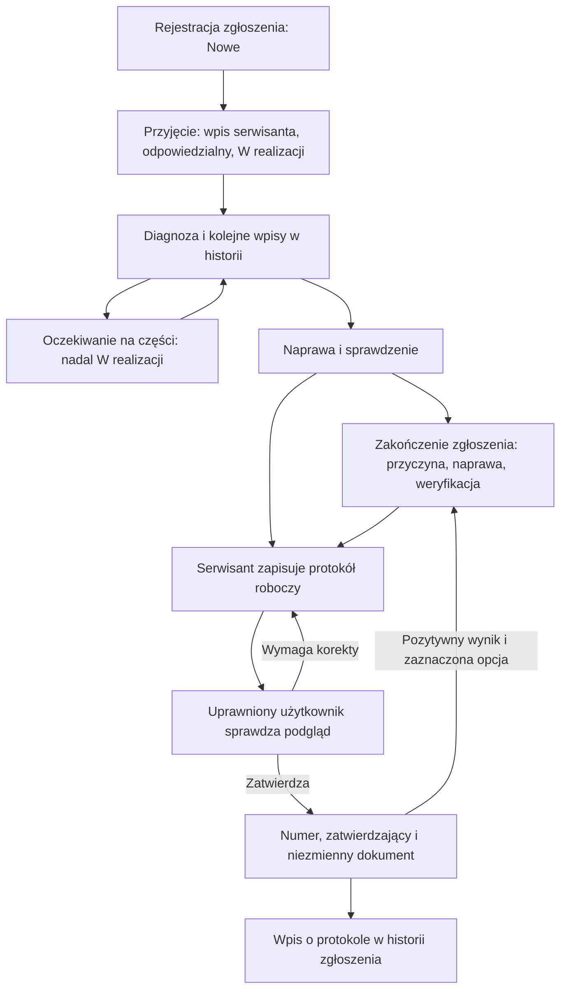

# Zgłoszenie, naprawa i zatwierdzenie protokołu — 2.12.11-TEST

Status pracy i status dokumentu są niezależne. Zakończona naprawa nie blokuje
wystawienia protokołu. Protokół roboczy nie zmienia statusu zgłoszenia.

## Kolejność pracy

1. Zarejestruj zgłoszenie: centrala, opis, zgłaszający, priorytet; przypisz
   odpowiedzialnego i termin, jeśli są znane.
2. Przez „Dodaj czynność / zmień status” zapisz przyjęcie i wybierz
   „W realizacji”. Każda wizyta jest osobnym wpisem z wykonawcą i datą.
   Oczekiwanie na części to etap prac, a nie zakończenie zgłoszenia.
3. Po naprawie możesz od razu zakończyć zgłoszenie, podając przyczynę,
   sposób usunięcia i wynik sprawdzenia. Możesz też pozostawić je otwarte
   do zatwierdzenia pozytywnego protokołu.
4. Wybierz „Wystaw protokół naprawy”, również dla zakończonej sprawy.
   Opis naprawy ze zgłoszenia jest podpowiedzią — sprawdź datę wykonania,
   wykonawcę, zakres, pomiary i wynik. Lista zgłoszeń obejmuje tylko wybraną centralę.
5. Zapisz szkic do zatwierdzenia. Dokument jest widoczny w „Protokoły i historia”
   i w karcie zgłoszenia. Nie ma jeszcze numeru; może być poprawiany przez
   użytkownika z prawem edycji szkiców. Nie ma osobnego powiadomienia ani
   przydzielania konkretnego zatwierdzającego.
6. Uprawniony użytkownik otwiera podgląd i wybiera „Zatwierdź protokół”.
   Jeżeli potrzebne są poprawki, pozostawia szkic do edycji serwisantowi.
   Zatwierdzenie nadaje numer, zapisuje osobę i czas, blokuje treść oraz
   dodaje informację do historii zgłoszenia.
7. „Zamknij powiązane zgłoszenie” działa tylko przy pozytywnym wyniku i
   otwartym zgłoszeniu. Już zakończone zgłoszenie zachowuje datę i opis naprawy.
   Zgłoszenie anulowane trzeba wznowić przed jego zakończeniem protokołem.

Zakończoną naprawę można także udokumentować dla centrali archiwalnej.
Nowy przegląd centrali archiwalnej wymaga jej przywrócenia. Zatwierdzonych
dokumentów nie edytuje się — do korekty służy protokół uzupełniający.

## Uprawnienia nadawane przez administratora

W „Użytkownicy” → „Edytuj” → „Dostęp do funkcji”:

| Osoba | Potrzebne uprawnienia |
| --- | --- |
| Serwisant | Podgląd i obsługa zgłoszeń, podgląd protokołów, tworzenie i edycja szkiców |
| Zatwierdzający | Podgląd protokołów oraz **Zatwierdzanie protokołów i przeglądów** |
| Zatwierdzający z możliwością poprawek | Powyższe oraz tworzenie i edycja szkiców |

Nowe konta z domyślną rolą SERWISANT nie otrzymują prawa zatwierdzania.
**Istniejące konta zachowują wcześniej przyznane uprawnienia.** Administrator
powinien odznaczyć zatwierdzanie serwisantom, którzy nie mają go mieć.
Administrator zawsze posiada komplet uprawnień. Nie wprowadzono obowiązku
zatwierdzenia przez inną osobę niż autor: decyduje posiadane uprawnienie.

Kontrola działa również na serwerze. Zatwierdzający bez prawa edycji może
zatwierdzić niezmieniony szkic, ale nie może przy okazji zmienić jego treści.
Blokady rekordów i kontrola wersji chronią przed jednoczesnymi zmianami.

## Weryfikacja

47 testów Python, testy JavaScript i test Chromium. Nowe scenariusze:
protokół po zakończeniu, zachowanie daty zamknięcia, dokumentacja archiwalna,
szkic bez skutków ubocznych, zakończenie przez zatwierdzenie, błędne powiązanie
central, brak prawa zatwierdzania, zatwierdzający bez prawa edycji i próba
nieuprawnionej zmiany treści. W przeglądarce sprawdzono pracę dwóch kont:
serwisant zapisuje szkic, kierownik zatwierdza go bez uprawnienia edycji.
Testy używają danych syntetycznych na Linux; runtime Windows pozostaje bez zmian.
